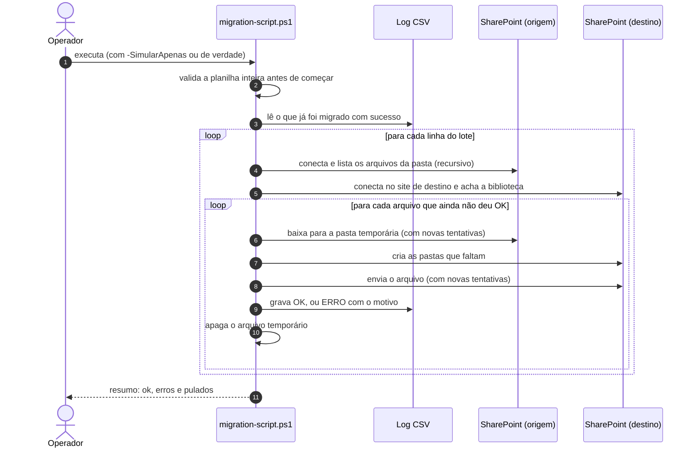
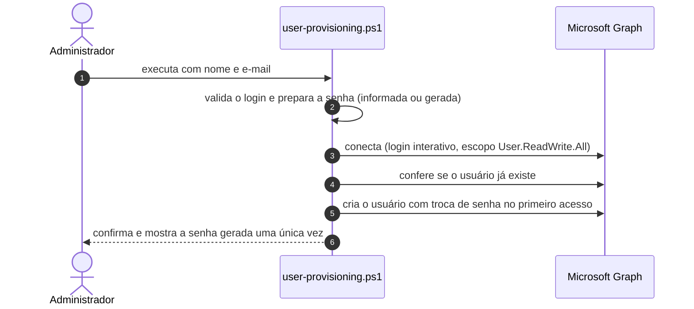

# Automação Microsoft 365 e Migração de SharePoint

## Sumário

1. [Objetivo](#1-objetivo)
2. [Stack](#2-stack)
3. [Arquitetura](#3-arquitetura)
    - 3.1. [Diagrama de fluxo](#31-diagrama-de-fluxo)
    - 3.2. [Estrutura de diretório](#32-estrutura-de-diretório)
4. [Variáveis de configuração](#4-variáveis-de-configuração)
5. [Infraestrutura e execução](#5-infraestrutura-e-execução)
6. [Guia do desenvolvedor](#6-guia-do-desenvolvedor)

## 1. Objetivo

Scripts em PowerShell para rotinas administrativas do Microsoft 365 e para a **migração de bibliotecas do SharePoint Online** de subsites para sites independentes.

Nasceram de um projeto real de migração (cerca de **2,65 TB e 1 milhão de arquivos**), que seguiu um processo de validação, cópia delta e virada (cutover). Este repositório guarda as **ferramentas**: não contém dados, nomes de clientes, endereços nem credenciais de nenhum ambiente.

| Projeto | O que faz |
|---|---|
| **SharePoint Migration Tool** (principal) | Lê uma planilha de pastas de origem e destino, baixa os arquivos um a um, recria a estrutura de pastas no site de destino, envia e registra o resultado de cada arquivo. **Retoma de onde parou**, refaz falhas de rede e tem modo de simulação |
| **Exchange Retention** | Aplica uma política de retenção a uma ou mais caixas de e-mail e dispara o Managed Folder Assistant, com resumo e `-WhatIf` |
| **User Provisioning** | Cria um usuário no Microsoft 365 pelo Microsoft Graph, com senha inicial forte e troca obrigatória no primeiro acesso |

## 2. Stack

| Camada | Tecnologia |
|---|---|
| Linguagem | PowerShell 5.1 ou 7 (arquivos só ASCII, por causa do 5.1) |
| SharePoint Online | módulo [PnP.PowerShell](https://pnp.github.io/powershell/), com login interativo e um aplicativo registrado no Entra ID |
| Exchange Online | módulo `ExchangeOnlineManagement` |
| Usuários | [Microsoft Graph PowerShell](https://learn.microsoft.com/powershell/microsoftgraph/) (`Microsoft.Graph.Users`) |
| Testes | Pester 3.4 ou mais novo, com o PnP simulado (mocks) |

## 3. Arquitetura

### 3.1. Diagrama de fluxo

Migração de uma pasta do SharePoint (um ciclo para cada linha da planilha):



Criação de usuário:



### 3.2. Estrutura de diretório

```
sharepoint-migration-tool/
    migration-script.ps1     Script principal de migração
    Migracao.psm1            Funções auxiliares (URLs, planilha, log, retomada, novas tentativas)
    exemplo-match.csv        Exemplo do formato da planilha de entrada
exchange-retention/
    retention-policy.ps1     Política de retenção e Managed Folder Assistant
user-provisioning/
    user-provisioning.ps1    Criação de usuário no Microsoft 365 (Graph)
    Provisionamento.psm1     Validação de login, apelido de e-mail e gerador de senha
Testes/
    M365.Tests.ps1           Testes Pester (funções, scripts com PnP simulado e sintaxe)
```

## 4. Variáveis de configuração

Tudo é parâmetro do script, com os mesmos valores padrão da versão original. Em `migration-script.ps1`:

| Parâmetro | Padrão | Descrição |
|---|---|---|
| `-CsvPath` | `C:\Temp\Migracao\MATCH_FINAL_OK.csv` | Planilha com as pastas a migrar (colunas `NomePasta`, `SourceUrl`, `TargetUrl`; veja `exemplo-match.csv`) |
| `-TempPath` | `C:\Temp\MigrationTemp` | Pasta temporária dos downloads (só um arquivo por vez fica nela) |
| `-LogPath` | `C:\Temp\Migracao\log_migracao.csv` | Log com `DataHora`, `Pasta`, `Arquivo`, `Status` (`OK` ou `ERRO`) e `Mensagem` |
| `-ClientId` | variável `SPMIG_CLIENT_ID` | ID do aplicativo registrado no Entra ID (obrigatório; nada é guardado no repositório) |
| `-BatchSize` | `1` | Quantas linhas da planilha processar por execução |
| `-StartIndex` | `0` | A partir de qual linha começar |
| `-Bibliotecas` | `Documentos Compartilhados`, `Shared Documents` | Nomes de biblioteca aceitos nas URLs de origem |
| `-Tentativas` | `3` | Tentativas de download e de envio (esperas de 5 s, 10 s...) |
| `-SimularApenas` | desligado | Lista o que seria migrado, sem baixar, criar pasta nem enviar |

`retention-policy.ps1`: `-Mailbox` (uma ou várias, aceita pipeline), `-PoliticaRetencao`, `-NaoExecutarAssistente` e `-WhatIf`.
`user-provisioning.ps1`: `-Nome`, `-Email`, `-UsageLocation` (padrão `BR`), `-SenhaInicial` (opcional, `SecureString`) e `-WhatIf`.

## 5. Infraestrutura e execução

Não há servidor nem pipeline: os scripts rodam na máquina do administrador, com login interativo no Microsoft 365.

1. Instale os módulos: `PnP.PowerShell`, `ExchangeOnlineManagement` e `Microsoft.Graph.Users`.
2. Para a migração, registre um aplicativo no Entra ID com permissão delegada ao SharePoint e guarde o ID em `SPMIG_CLIENT_ID`.
3. Monte a planilha de pastas (veja `exemplo-match.csv`).
4. Rode primeiro com `-SimularApenas`, depois em lotes pequenos (`-BatchSize`), conferindo o log antes de aumentar.

## 6. Guia do desenvolvedor

```powershell
# módulos usados
Install-Module PnP.PowerShell, ExchangeOnlineManagement, Microsoft.Graph.Users -Scope CurrentUser

# migração: primeiro simule, depois migre
$env:SPMIG_CLIENT_ID = '<id do aplicativo>'
.\sharepoint-migration-tool\migration-script.ps1 -SimularApenas
.\sharepoint-migration-tool\migration-script.ps1 -BatchSize 5 -StartIndex 0

# retenção e criação de usuário (sempre dá para testar com -WhatIf)
.\exchange-retention\retention-policy.ps1 -Mailbox ana@contoso.com -PoliticaRetencao "Retencao 5 anos" -WhatIf
.\user-provisioning\user-provisioning.ps1 -Nome "Ana Souza" -Email ana.souza@contoso.com -WhatIf

# testes
Invoke-Pester .\Testes
```

**O que os testes cobrem.** Funções de URL, planilha, log, retomada e novas tentativas; o gerador de senha; e o script de migração inteiro rodando com o PnP simulado (migrar, retomar, erro em um arquivo, falha passageira de rede, simulação e parâmetros ausentes). Também conferem a sintaxe e o ASCII dos scripts.

**O que não foi testado.** Os scripts não foram executados contra um tenant real depois desta revisão: o uso dos cmdlets do PnP, do Exchange e do Graph (parâmetros `-Connection`, `-ReturnConnection`, `New-MgUser`) segue a documentação, mas deve ser validado com `-SimularApenas` e `-WhatIf` num ambiente de teste antes de uso em produção.

**Limitações conhecidas**

- O script assume bibliotecas chamadas `Documentos Compartilhados` ou `Shared Documents` (configurável em `-Bibliotecas`) e envia para a primeira biblioteca de documentos visível do destino.
- Arquivos novos no destino são enviados com o nome original: se já existir um arquivo com o mesmo nome na pasta, vale o comportamento padrão do `Add-PnPFile`.
- A validação, a cópia delta e a virada do projeto original foram etapas do processo, **não** estão neste script: ele copia e registra.
- Metadados (autor, datas de criação e modificação), permissões e versões anteriores dos arquivos não são migrados.
- O log novo tem cabeçalho; o log antigo (sem cabeçalho) ainda é lido para a retomada.
